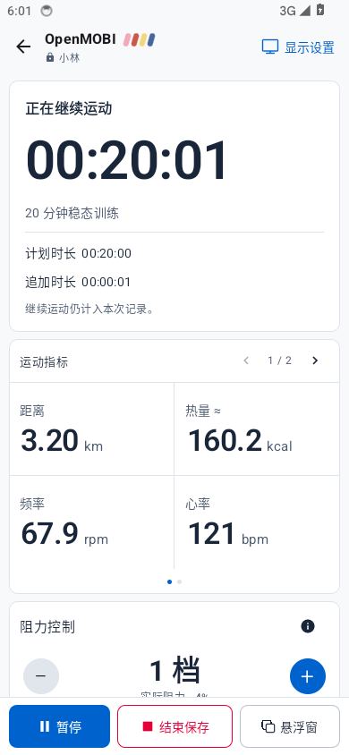
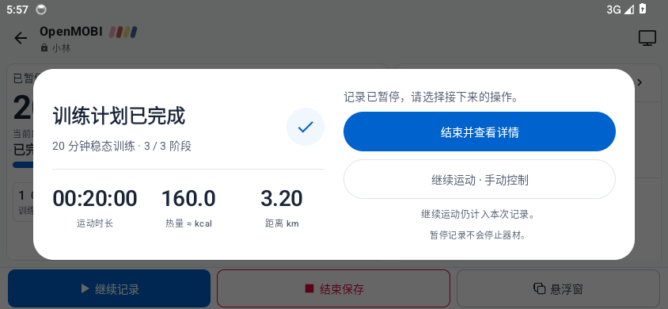

# v0.3.4 验证 / Validation

[版本说明](releases/v0.3.4.md) · [设备支持](COMPATIBILITY.md) · [历史审计](REA_AUDIT.md)

本次同时检查原始协议计算、应用记录链和真实 Compose 页面。两版官方 APK 的原始 DEX 接收相同输入；官方不是所有规则的最终正确答案，因此另用独立不变量检查双方共同遗漏。测试不使用真实器材发送控制。

## 实现及回归

| 规则／行为 | 修复与验证入口 |
| --- | --- |
| A01–A03：AT-R | V1 类型 10／子型 1 且名称 AT-R 前缀采用设备转数换算虚拟距离；静默不继续积分。按 Issue #1 允许 1–24 写入，区分设定值和反馈。没有证据将其改为 0–23 |
| A04–A06、A11：时效与派生量 | 每个指标分别记录接收时间；部分踏频／曲线包不刷新旧速度、功率。停止／过期后步幅失效。`ProtocolRecordingRegressionTest` 经 BleClient、Controller、Room 验证四类器材 |
| A07：累计计数 | 使用报文来源声明的位宽，限定回绕窗口；复位、暂停、重连重新建立基线。额外拒绝单帧巨大正向突跳，同时允许按报告间隔计算的合理批量增量 |
| A08、A12：无效数据 | 磁铁数 0 不生成正常频率；FTMS 非有限／越界／哨兵运动量清除旧值，不进入记录。保留协议允许的有符号力和实测功率 |
| A09、A10：初始化及元数据 | 先启动所需实时上报，再等待累计传感读数创建记录；有界超时。补齐 2A19 电量和 8804 采集比例 |
| A13、A14：零档 | 声明范围包含 0 时反馈可确认 0，且更新算法输入；无符号 128–255 边界不再变成负数。不把合成档位范围等同真实型号能力 |
| FTMS 小数步长 | 完整六字节范围保留小数增量；245 个可达 0.1 档编码逐个检查。旧四字节厂商格式保持原规则；MOBI 两字节命令范围超过 25.5 时只读 |
| 展开／收起 | V1 命令 7、V2 8903 的串行 GATT 写入、状态复核、重复点击、超时和只读刷新有测试。发送成功不等同机械完成，必须等待状态反馈 |
| 计划结束 | 延迟 tick 也按最终定时边界停止累计；完成只触发一次。等待时间不入账，继续沿用同一记录且关闭自动调阻；重启恢复、断连、保存失败、Room 迁移与 CSV 往返有回归 |
| 通知／悬浮窗 | 待选择状态显示完成和打开应用入口，不通过旧“继续”动作绕过选择；手动追加后不再显示旧阶段进度 |

主要测试：`ProtocolBoundaryTest`、`ProtocolRecordingRegressionTest`、`ZeroResistanceRegressionTest`、`PlanCompletionTest`、`BleClientTest`、`RepositoryTest`、`OverlayPanelViewTest`。原始 oracle 期望表保留；有意拒绝厂商无效值的情况在断言中明确列出，不让新实现生成自己的正确答案。

## 相同输入的三方 DEX 执行

输入生成器、运行器和比较器位于 [tools/protocol-differential](../tools/protocol-differential/README.md)。主集、补集、新划船子型、特殊规则和 v0.3.4 极端复归集共 **3,092 条独立序列、每份 APK 30,164 步**；另有 80 条逆序重放检查状态污染。覆盖六类器材、能力先后顺序、上传模式、零／一档下限、无符号边界、小数增量、截断报文、部分字段、无效值恢复、计数回绕／复位及划船脉冲扰动。

| 原始 APK | SHA-256 |
| --- | --- |
| 国际版 2.1.14 | `1bd01d47b07ca73235354c6a9b7d0cbf26d60d88fd0b8ca8b7ef0e47128775d8` |
| 中文版 4.5.16.1 | `99af8aeb883d56bd724ebdadd1114caf79ab7bef34c4b96488d0c2ced7be19e4` |

DEX 注入点是接收处理器和选定 MotionData 算法链，未启动官方完整 Application/UI、真实计时结算、云端或最终上传。应用记录行为由独立的 OpenMOBI 回归验证，不能说全部序列都跑过官方 UI 或 Room。默认零／缺测、估算／实测、厂商错误边界、元数据和未映射字段全部保留为差异，不把差异条数叫作缺陷数量。

| 输入批次 | 序列 | 每份 APK 步数 | 每个官方参考的映射比较 | 原始差异 |
| --- | ---: | ---: | ---: | ---: |
| 主集 | 2,736 | 20,770 | 62,068 | 20,135 |
| 定向补集 | 20 | 352 | 1,027 | 440 |
| 新划船子型 | 16 | 260 | 1,404 | 336 |
| 特殊规则 | 136 | 4,430 | 11,108 | 3,284 |
| 极端值与复归 | 184 | 4,352 | 29,470 | 13,233 |

两份官方参考分别比较，以上计数相同。原始差异包含回调默认值与缺测、原始小数功率与整数显示功率、设备元数据、额外指标及刻意修正的厂商边界行为，**不是失败用例或缺陷数量**。新划船扰动集的 700 个原始拉力差异分别为 687 次静止时清除旧拉力、13 次越界拒绝；速度和桨频回调没有数值差异。功率差异为取整、静止或有效性处理。

输入／输出完整性和逆序重复检查通过；初始化、下游转发和 OpenMOBI 未捕获异常为 0。每版官方仍有 106 次报文步骤异常，其中 48 次涉及截断范围触发 Firebase 初始化依赖，其余为原处理器的边界异常；均保留，不计为匹配成功，也不推断完整官方 App 会崩溃。

新增跑步机的首轮 15 次下游结算环境错误已通过显式 `initialSportState=STOP` 修正测试初始化后重跑；已有含开始状态的序列仍保持 START。原始失败证据保留，没有修改原始 DEX 或报文。简明机器可读证据见 [v034-results.json](../tools/protocol-differential/v034-results.json)。

## 原生界面检查

专用 Android 模拟器运行 `V034UiTest`，真实 Compose、Controller 和 Room，使用明确标注的虚拟读数。检查完成选择、保存失败、手动追加、详情、展开／收起入口、确认、等待、超时、未知状态和无能力隐藏。

- 390×844、320×640、844×390、1280×853，浅色／深色，以及 2 倍字体。
- 自动断言勾勾在标题＋方案说明的右侧，按整个文字块垂直居中；返回键不能关闭选择；统计与保存错误可见；继续关闭自动调阻；不支持器材不出现操作卡。
- 人工视觉复查发现窄屏说明被截掉、横屏统计区过窄，已改为紧凑统计、固定操作说明和横屏左右两栏，并重跑受影响矩阵。
- 截图仅使用测试档案和模拟记录，不是器材实测图。

核心 **85**、Debug 应用 **123**、Release 应用 **117** 项单元测试通过，均为 0 失败／0 错误／0 跳过。两种 Lint、资源完整性、Debug／Release 及 instrumentation 构建通过。普通版和 Debug 版分别保持与 v0.3.3 相同的证书指纹；APK ZIP 和全部 arm64-v8a／x86_64 ELF LOAD 段均满足 16 KiB 对齐。

普通版从 v0.3.3（13）覆盖升级到 v0.3.4（14），既有 1 个档案、2 个方案、2 条记录、2 个采样的全部旧字段逐列一致，新增字段为空／false。数据库实际完成 8→9 迁移。普通版设备页视觉检查无演示入口；Debug 保留原证书并覆盖安装。

最终构建的六组原生流程全部通过，共 **60 张状态截图逐张视觉复查**。窄屏与横屏继续运动页面的滚动范围已修正，完整矩阵重新通过。下面是最终 APK 的模拟数据截图。

| 计划完成 | 手动继续 | 连接页操作 |
| --- | --- | --- |
|  |  |  |

## 明确保留的边界

- 各型号×硬件码×固件、无线丢包、真实电机／折叠机构及人体功率／热量标定未逐一实测。已有硬件证据限于历史 MB-EP 日志及 Issue #1 的 AT-R 反馈。
- 0／1 折叠状态没有可确认的展开／收起姿态映射，使用合并操作名；未知状态不发动作。跑步机开始、速度和坡度控制仍不开放。
- 原始 DEX 还有逐桨拉回时间、长度、评分等字段，未成为新的产品指标。3209 自动型号选择及 8815／8816 离线历史没有充分入口证据，仍不猜测接入。
- 有限序列覆盖不能证明“所有设备特殊规则已全量核验”；后续真实反馈仍可能揭示新的规则。诊断报文有序号、单调时钟及丢弃计数，但有界日志不是无限无损抓包。

## English

The release combines three-way original-DEX replay, independent product invariants, real Controller/Room/GATT tests and native Compose visual checks. The same 3,092 sequences (30,164 input steps per APK, plus 80 reverse-order repeats) run through both official APKs and OpenMOBI. Vendor defaults, malformed-input behavior, deliberate corrections and unmapped fields remain visible; equality alone is not proof of correctness.

The new UI preserves a single record for manual continuation, excludes decision time and restores pending choices after restart. Folding requires a declared capability, idle equipment, known state and confirmation, followed by feedback. The completion checkmark sits to the right of the combined heading/subtitle block.

These checks do not establish complete hardware/firmware coverage, mechanical safety, official full-app recording parity or calibrated exercise energy. Unconfirmed stroke-detail features, 3209 selection and offline histories remain outside implemented support. See the evidence tables and execution summary above for exact counts and limitations.
